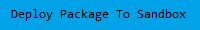

# Record Types

This is a project based on work by [Evan Callahan](https://github.com/groundwired) (formerly of Groundwire, and now at Salesforce) who wrote [this class](https://github.com/SalesforceFoundation/JenkinsTesting/blob/master/src/classes/RecordTypes.cls) (repo has been deleted - Sadface) a long time ago to reduce the number of describe calls required to work with Record Types.

I've updated the project (by pulling test code out of the main class - that's how old it was!) and have added some additional methods. The included test class has 100% coverage, so pull this into your org and get cracking!

Of note: The unpackaged test class assumes that you have no record types for the Solution object. If you do, you may need to remove that test method.

<!--  -->

## The Code

The class and test class are found in this [folder](https://github.com/dschach/record-types/tree/main/force-app/main/default/classes). Feel free to copy/paste directly into your org.

## Features

Given combinations of an sObject name, Record Type name, Record Type developer name, and Record Type Id, this class will let you return the other possible parameters. Give it an sObject name and a Record Type developer name, and get the Record Type Id.

The main purpose is to minimize describe calls, which will speed up your code.

## Documentation

[Documentation](https://dschach.github.io/record-types/RecordTypes.html) (generated with [ApexDox](https://github.com/no-stack-dub-sack/apexdox-vs-code))

## Package Installation

## Installation (with VCS)

Clone this repository and run `bash scripts/orginit.sh` to set up a scratch org with the classes installed and a single Account Record Type.

To set up a scratch org without creating a Record Type, run `bash scripts/orginit-norecordtypes.sh`

## [Changelog](./CHANGELOG.md)

- 2026-11

  - Update to API 68.0
  - Faster tests: no global describe, and shared assertions instead of duplicated test methods
  - Test classes declare the class they test with `@IsTest(testFor=...)`
  - Cover the default and available Record Type paths with a test-only profile that makes the `Default` Account Record Type the default
  - Run PMD from one reusable workflow on pull requests and on every push to `main`, and upload code coverage on every push to `main`

- 2026-10

  - Install Salesforce Code Analyzer and update PMD ruleset

- 2024-03

  - All methods are now case-insensitive
  - Dynamic describe methods remove need for global describe (faster code!)
  - Move Solution tests - does not increase coverage - to unpackaged test class

- 2024-02

  - Enhance SelectList methods
  - Update to API 60.0
  - Increase code coverage and test cases

- 2023-09

  - Overload getRecordTypeFromId so it doesn't require a SobjectType string
  - Release unlocked package

- 2023-08

  - Add methods to get default RecordTypeId, handling situation where no RT is on the Profile but at least one is avaialble via Permission Set.
  - Add test methods against Account and Solution objects, as we assume Solution has no defined record types. (Change for your org if you have them.)
  - Include table of all methods on documentation site

- 2022-03

  - BREAKING CHANGE: Replaced "DeveloperName" with "DevName" in all method names. Update your code to refer to the new methods.

- 2022-03

  - Add maps Id => Name and Id => DeveloperName for ease of use when wanting to refer to a record type by Id without including the object, since Id is globally unique

- 2022-01
  - Initial Release

## Code Header

Written by Evan Callahan, copyright &copy; 2010 Groundwire

- This program is released under the [GNU General Public License](https://github.com/dschach/record-types/blob/main/LICENSE). http://www.gnu.org/licenses/
- This class is meant to allow for access to Record Type information from within other classes.
- It is called statically, and therefore will supply the same information to all calls made from within one transaction, or set of trigger calls. This is beneficial because this info should be the same for all calls in a transaction, and by calling it statically we reduce the calls that are made, making the total transaction more efficient.

Updated by David Schach, copyright &copy; X-Squared on Demand

- Usage recommendation: Always use DeveloperName instead of Name, as this is more likely to be hard-coded in places, while the Name is actually a label and may change (especially due to user language).

# Library Methods

(Full documentation at [https://dschach.github.io/record-types](https://dschach.github.io/record-types/))

## Most Common Methods

These are the most common methods to be used. They are the fastest ways to get a Record Type Id from an object name and the developer name, for example.

There are some overloaded methods included for historical purposes (the ones that accept a Record Type Id and an object name and return the developer name).
While the object name is, technically, optional, that method is faster because it does not require memoizing a SOQL query.

  <table class="methodtable">
    <thead><tr><th scope="col">Given</th><th scope="col">Returns</th><th scope="col">Method</th></tr></thead>
    <tbody>
      <tr><td><code>objectName</code>, <code>recordTypeName</code></td><td>Id</td><td><a href="https://dschach.github.io/record-types/RecordTypes.html#RecordTypes.getRecordTypeIdFromName"><code>getRecordTypeIdFromName</code></a></td></tr>
      <tr><td><code>objectName</code>, <code>recordTypeName</code></td><td>DeveloperName</td><td><a href="https://dschach.github.io/record-types/RecordTypes.html#RecordTypes.getRecordTypeDevNameFromName"><code>getRecordTypeDevNameFromName</code></a></td></tr>
      <tr class="recommended"><td><code>objectName</code>, <code>recordTypeDevName</code></td><td>Id</td><td><a href="https://dschach.github.io/record-types/RecordTypes.html#RecordTypes.getRecordTypeIdFromDevName"><code>getRecordTypeIdFromDevName</code></a> most used</td></tr>
      <tr><td><code>objectName</code>, <code>recordTypeDevName</code></td><td>Name</td><td><a href="https://dschach.github.io/record-types/RecordTypes.html#RecordTypes.getRecordTypeNameFromDevName"><code>getRecordTypeNameFromDevName</code></a></td></tr>
      <tr><td><code>objectName</code>, <code>recordTypeId</code></td><td>Name</td><td><a href="https://dschach.github.io/record-types/RecordTypes.html#RecordTypes.getRecordTypeNameFromId"><code>getRecordTypeNameFromId</code></a></td></tr>
      <tr><td><code>objectName</code>, <code>recordTypeId</code></td><td>DeveloperName</td><td><a href="https://dschach.github.io/record-types/RecordTypes.html#RecordTypes.getRecordTypeDevNameFromId"><code>getRecordTypeDevNameFromId</code></a></td></tr>
      <tr><td><code>recordTypeId</code></td><td>Name</td><td><a href="https://dschach.github.io/record-types/RecordTypes.html#RecordTypes.getRecordTypeNameFromId_1"><code>getRecordTypeNameFromId</code></a></td></tr>
      <tr><td><code>recordTypeId</code></td><td>DeveloperName</td><td><a href="https://dschach.github.io/record-types/RecordTypes.html#RecordTypes.getRecordTypeDevNameFromId_1"><code>getRecordTypeDevNameFromId</code></a></td></tr>
    </tbody>
  </table>

## Helper Methods

These methods check record types available to the current/running user.

  <table class="methodtable">
    <thead><tr><th scope="col">Given</th><th scope="col">Returns</th><th scope="col">Method</th></tr></thead>
    <tbody>
      <tr><td><code>objectName</code>, <code>recordTypeDevName</code></td><td>Boolean</td><td><a href="https://dschach.github.io/record-types/RecordTypes.html#RecordTypes.isRecordTypeAvailable"><code>isRecordTypeAvailable</code></a></td></tr>
      <tr><td><code>objectName</code>, <code>recordTypeDevName</code></td><td>Boolean</td><td><a href="https://dschach.github.io/record-types/RecordTypes.html#RecordTypes.isRecordTypeDefault"><code>isRecordTypeDefault</code></a></td></tr>
    </tbody>
  </table>

## Default Record Type Methods

These methods return the default Record Type for the current/running user.

  <table class="methodtable">
    <thead><tr><th scope="col">Given</th><th scope="col">Returns</th><th scope="col">Method</th></tr></thead>
    <tbody>
      <tr><td><code>objectName</code></td><td><code>Schema.RecordTypeInfo</code></td><td><a href="https://dschach.github.io/record-types/RecordTypes.html#RecordTypes.getDefaultRecordType"><code>getDefaultRecordType</code></a></td></tr>
      <tr><td><code>objectName</code></td><td>Id (<code>null</code> if the default is Master)</td><td><a href="https://dschach.github.io/record-types/RecordTypes.html#RecordTypes.getDefaultRecordTypeId"><code>getDefaultRecordTypeId</code></a></td></tr>
      <tr><td><code>objectName</code></td><td>Name (<code>Master</code> if the default is Master)</td><td><a href="https://dschach.github.io/record-types/RecordTypes.html#RecordTypes.getDefaultRecordTypeName"><code>getDefaultRecordTypeName</code></a></td></tr>
      <tr><td><code>objectName</code></td><td>DeveloperName (<code>Master</code> if the default is Master)</td><td><a href="https://dschach.github.io/record-types/RecordTypes.html#RecordTypes.getDefaultRecordTypeDevName"><code>getDefaultRecordTypeDevName</code></a></td></tr>
    </tbody>
  </table>

## Less Common Methods

The most useful of these may be the SelectList generators for Visualforce. However, if you are using LWC, you may prefer to use some of the other methods and to parse the returned list of RecordTypeInfo items yourself.

  <table class="methodtable">
    <thead><tr><th scope="col">Given</th><th scope="col">Returns</th><th scope="col">Method</th></tr></thead>
    <tbody>
      <tr class="group"><th scope="colgroup" colspan="3">RecordTypeInfo</th></tr>
      <tr><td><code>recordTypeId</code></td><td><code>Schema.RecordTypeInfo</code></td><td><a href="https://dschach.github.io/record-types/RecordTypes.html#RecordTypes.getRecordTypeFromId"><code>getRecordTypeFromId</code></a></td></tr>
      <tr><td><code>objectName</code>, <code>recordTypeId</code></td><td><code>Schema.RecordTypeInfo</code></td><td><a href="https://dschach.github.io/record-types/RecordTypes.html#RecordTypes.getRecordTypeFromId_1"><code>getRecordTypeFromId</code></a></td></tr>
      <tr><td><code>objectName</code>, <code>recordTypeName</code></td><td><code>Schema.RecordTypeInfo</code></td><td><a href="https://dschach.github.io/record-types/RecordTypes.html#RecordTypes.getRecordTypeFromName"><code>getRecordTypeFromName</code></a></td></tr>
      <tr><td><code>objectName</code>, <code>recordTypeDevName</code></td><td><code>Schema.RecordTypeInfo</code></td><td><a href="https://dschach.github.io/record-types/RecordTypes.html#RecordTypes.getRecordTypeFromDevName"><code>getRecordTypeFromDevName</code></a></td></tr>
      <tr><td><code>objectName</code></td><td><code>List&lt;Schema.RecordTypeInfo&gt;</code></td><td><a href="https://dschach.github.io/record-types/RecordTypes.html#RecordTypes.getRecordTypesForObject"><code>getRecordTypesForObject</code></a></td></tr>
    </tbody>
    <tbody>
      <tr class="group"><th scope="colgroup" colspan="3">Sets of Ids</th></tr>
      <tr><td><code>objectName</code></td><td><code>Set&lt;Id&gt;</code> of the available Record Types</td><td><a href="https://dschach.github.io/record-types/RecordTypes.html#RecordTypes.getAvailableRecordTypesIdSet"><code>getAvailableRecordTypesIdSet</code></a></td></tr>
      <tr><td><code>objectName</code>, <code>Set&lt;recordTypeDevName&gt;</code></td><td><code>Set&lt;Id&gt;</code></td><td><a href="https://dschach.github.io/record-types/RecordTypes.html#RecordTypes.getRecordTypeIdSetFromDevNames"><code>getRecordTypeIdSetFromDevNames</code></a></td></tr>
    </tbody>
    <tbody>
      <tr class="group"><th scope="colgroup" colspan="3">Maps of Ids</th></tr>
      <tr><td><code>objectName</code></td><td><code>Map&lt;String, Id&gt;</code> by DeveloperName</td><td><a href="https://dschach.github.io/record-types/RecordTypes.html#RecordTypes.getRecordTypeDevNameIdMap"><code>getRecordTypeDevNameIdMap</code></a></td></tr>
      <tr><td><code>objectName</code></td><td><code>Map&lt;String, Id&gt;</code> by Name</td><td><a href="https://dschach.github.io/record-types/RecordTypes.html#RecordTypes.getRecordTypeNameIdMap"><code>getRecordTypeNameIdMap</code></a></td></tr>
      <tr><td><code>objectName</code></td><td><code>Map&lt;String, Id&gt;</code> by DeveloperName, available Record Types only</td><td><a href="https://dschach.github.io/record-types/RecordTypes.html#RecordTypes.getAvailableRecordTypeDevNameIdMap"><code>getAvailableRecordTypeDevNameIdMap</code></a></td></tr>
      <tr><td><code>objectName</code></td><td><code>Map&lt;String, Id&gt;</code> by Name, available Record Types only</td><td><a href="https://dschach.github.io/record-types/RecordTypes.html#RecordTypes.getAvailableRecordTypeNameIdMap"><code>getAvailableRecordTypeNameIdMap</code></a></td></tr>
    </tbody>
    <tbody>
      <tr class="group"><th scope="colgroup" colspan="3">Visualforce select lists</th></tr>
      <tr><td><code>objectName</code></td><td><code>List&lt;SelectOption&gt;</code> of all Record Types, unavailable ones disabled</td><td><a href="https://dschach.github.io/record-types/RecordTypes.html#RecordTypes.getAllRecordTypesForSelectList"><code>getAllRecordTypesForSelectList</code></a></td></tr>
      <tr><td><code>objectName</code>, <code>disableUnavailable</code></td><td><code>List&lt;SelectOption&gt;</code> of all Record Types, disabling the unavailable ones only if <code>true</code></td><td><a href="https://dschach.github.io/record-types/RecordTypes.html#RecordTypes.getAllRecordTypesForSelectList_1"><code>getAllRecordTypesForSelectList</code></a></td></tr>
      <tr><td><code>objectName</code></td><td><code>List&lt;SelectOption&gt;</code> of the available Record Types</td><td><a href="https://dschach.github.io/record-types/RecordTypes.html#RecordTypes.getAvailableRecordTypesForSelectList"><code>getAvailableRecordTypesForSelectList</code></a></td></tr>
      <tr><td><code>objectName</code></td><td><code>List&lt;SelectOption&gt;</code> with the Name as the value</td><td><a href="https://dschach.github.io/record-types/RecordTypes.html#RecordTypes.getStringRecordTypesForSelectList"><code>getStringRecordTypesForSelectList</code></a></td></tr>
    </tbody>
  </table>

